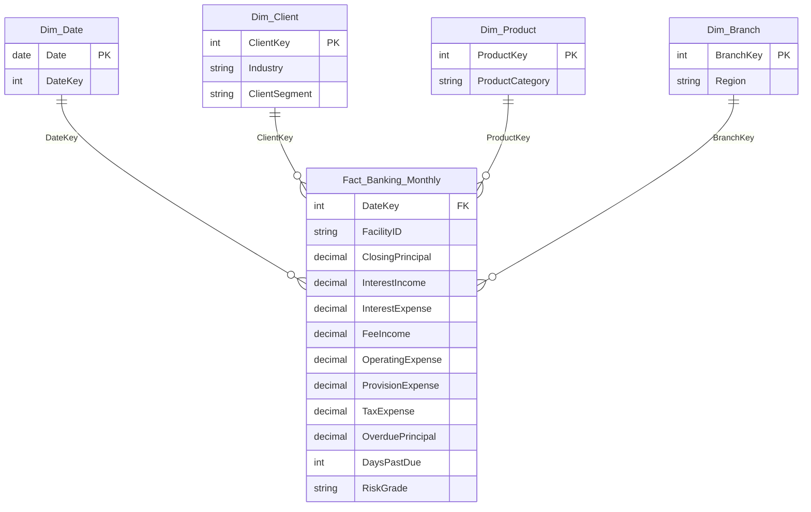

# 🏦 Nexus Corporate Bank — Profitability & Credit Risk Dashboard (Power BI)


> A 3-page Power BI report that explains **why a corporate bank's profit and margins moved during 2025** and **where credit stress is building**, built on a star schema with snapshot-vs-flow DAX logic and a time-period calculation group.


---

## ⚡ 30-Second Summary

| | |
| :--- | :--- |
| **Domain** | Corporate banking: lending P&L, funding cost, credit risk |
| **Business question** | Why did Net Profit and NIM swing month to month, and which clients/facilities drive credit stress? |
| **Data** | Synthetic: 2,880 monthly fact rows, 120 clients, 240 facilities, 4 loan products, 8 branches, Jan–Dec 2025 |
| **Tools** | Power BI Desktop, DAX, Calculation Groups, Star-schema modelling |
| **What's in it** | 3 report pages, 35 DAX measures, 1 calculation group (Normal / MTD / QTD / R3M), a 7-stage profit waterfall |
| **Headline result** | ₹20.74B loan book, ₹479.2M net profit, 5.05% NIM, 82% of book performing |

---

## 🎯 Business Problem

A corporate lending business tracks profit, funding cost, margins, overdue loans and provisions in separate views. This report puts them together to answer five management questions:

1. Why did Net Profit and Net Interest Margin (NIM) fluctuate month to month?
2. Did loan book growth turn into profit?
3. How much did rising Cost of Funds squeeze lending spreads?
4. Which industries, segments and facilities drive Days Past Due (DPD) and High-Risk Exposure?
5. How much did credit-loss provisions erode Net Profit?

---

## 💡 What the Data Says

| # | Finding | Evidence |
| :-: | :--- | :--- |
| 1 | **One provision spike turned a good year's only month into a loss.** September was the only loss-making month. | Provision Expense hit ₹76.79M against a typical ₹3.7–3.9M a month (~20x). Net Profit: **-₹7.46M** (NPM -8.0%) |
| 2 | **June's margin squeeze came from funding cost, not lending yield.** | Cost of Funds jumped to **6.01%** (about 5.0–5.15% in other months). Yield stayed ~9.7%. NIM fell to **4.15%** |
| 3 | **Credit stress built up through Q3 and peaked in October.** | Overdue Principal rose from ₹14.2M (Jan) to **₹252.9M (Oct)**, then eased to ₹115.0M by Dec |
| 4 | **A small group of dead facilities sits behind the worst DPD numbers.** | 6 facilities at **470 DPD** earn zero interest income. 90+ DPD exposure is ₹180.8M (0.87% of book) |
| 5 | **Risk is concentrated in a few named clients.** | Large Corporate client *Harbor Projects Pvt Ltd*: ₹568M book, 100% high-risk, ₹13.59M provision. High-Risk Exposure is 18% of the book |

**What I would recommend to management**
- Reprice or hedge funding ahead of rate-driven spikes: June shows Cost of Funds can erase ~1 point of NIM in one month.
- Treat 30+ DPD as a provisioning early-warning trigger: September's spike followed accounts crossing risk thresholds.
- Put the 470-DPD facilities and the 100%-high-risk Large Corporate clients on a restructuring watchlist.

---

## 🖼️ Dashboard Pages

| Page | What it answers | Key components |
| :--- | :--- | :--- |
| **1. Executive Overview** | Is the bank profitable, and is margin under pressure? | KPI cards (Loan Book, Interest Income, NII, Net Profit) with sparklines, NIM / CoF / Yield gauges, two monthly combo charts, 7-stage Profitability Bridge waterfall, Risk and Loan Exposure blocks, auto-written Smart Insights |
| **2. Facility Detail** | Which individual facilities are the problem? | 240-facility matrix sorted by Overdue Principal, conditional formatting on Risk Grade and DPD, data bars on limits |
| **3. Client Summary** | Which industries and clients drive risk? | Industry → Segment → Client drill-down with Loan Book, Interest Income, Net Profit, NIM, High-Risk %, Provision Amount |

All pages share a date range, Quarter slicer, and a **Scenario** slicer (Normal / MTD / QTD / R3M) driven by a calculation group.

<p>
  
  
</p>

---

## 🧠 Skills Demonstrated

| Skill | Where to see it |
| :--- | :--- |
| **Star-schema data modelling** | 1 fact + 4 dimensions, single-direction 1:* relationships, marked Date table, sort-by-column fixes |
| **Semi-additive measure design** | `Loan Book`, `Overdue`-type balances use a *last available snapshot* pattern so balances are never summed across months |
| **Calculation groups** | `Time Period` group replaces 80+ separate MTD/QTD/R3M measures with 4 items using `SELECTEDMEASURE()` |
| **Advanced DAX** | `VAR/RETURN`, `CALCULATE`, `REMOVEFILTERS`, `DATEADD`, `DATESMTD/QTD`, `DATESBETWEEN`, `SWITCH`, `SELECTEDVALUE`, `DIVIDE`, `UNICHAR` |
| **Dynamic visuals** | Disconnected `DATATABLE` driving a waterfall; DAX-built benchmark text and conditional-format colour measures |
| **Finance domain knowledge** | NII, NIM, Cost of Funds, Yield on Advances, provisions (ECL), DPD buckets, NPA, facility limits |
| **Analytical storytelling** | Findings framed as cause → impact → action, not just charts |
| **Model hygiene** | Measures in a dedicated `Z_Measures` table, 5 display folders, consistent naming |

---

## ⚙️ Three Technical Highlights

### 1. Flow vs Snapshot: avoiding the ₹242B mistake
Income and expense are **flows** (add up over time). Loan balances are **snapshots** (only the latest month-end counts). A naive `SUM` of the loan book across 12 months gives **₹242.39B**; the true figure is **₹20.74B**.

```dax
Loan Book =
VAR SelectedEndDate = MAX('Dim_Date'[Date])
VAR LastAvailableDateKey =
    CALCULATE(
        MAX('Fact_Banking_Monthly'[DateKey]),
        REMOVEFILTERS('Dim_Date'),
        'Fact_Banking_Monthly'[DateKey] <= VALUE(FORMAT(SelectedEndDate, "YYYYMMDD"))
    )
RETURN
CALCULATE(
    SUM('Fact_Banking_Monthly'[ClosingPrincipal]),
    REMOVEFILTERS('Dim_Date'),
    'Fact_Banking_Monthly'[DateKey] = LastAvailableDateKey
)
```
The calendar has every day but the data only has month-ends. This pattern returns the latest real snapshot on or before whatever date the user picks.

### 2. One calculation group instead of 80+ measures
```dax
R3M =
VAR EndDate   = MAX('Dim_Date'[Date])
VAR StartDate = EOMONTH(EndDate, -3) + 1
RETURN
CALCULATE(SELECTEDMEASURE(), DATESBETWEEN('Dim_Date'[Date], StartDate, EndDate))
```
Every KPI on every page responds to Normal / MTD / QTD / R3M without extra measures.

### 3. Dynamic profitability waterfall
A 7-row disconnected table plus `SWITCH(SELECTEDVALUE(...))` maps each P&L line to a signed value, walking **Interest Income ₹1.95B → Net Profit ₹0.48B** (Interest Expense -0.96B, Fee Income +0.09B, OpEx -0.32B, Provisions -0.13B, Tax -0.16B).

---

## 🏗️ Data Model


*Also in the model: `Profitability_Bridge` (disconnected helper), `Z_Measures` (measure container), `Time Period` calculation group. Fact table has 23 columns; full schema in [`docs/DATA_DICTIONARY_AND_VISUALS.md`](docs/DATA_DICTIONARY_AND_VISUALS.md).*

---

## 📊 FY 2025 KPI Scorecard

| Metric | Value | Context |
| :--- | ---: | :--- |
| Loan Book (Dec snapshot) | **₹20.74B** (₹2,074 Cr) | +7.6% vs Jan (₹19.28B); -0.2% vs Nov |
| Interest Income (FY) | **₹1.95B** | Peak month: Dec ₹174.2M; lowest: Feb ₹144.1M |
| Net Interest Income (FY) | **₹993.3M** | |
| Net Profit (FY) | **₹479.2M** | Only loss month: Sep (-₹7.5M) |
| Net Interest Margin | **5.05%** | Low 4.15% (Jun), high 5.40% (Dec) |
| Cost of Funds | **5.16%** | Peak 6.01% (Jun) |
| Yield on Advances | **9.91%** | Range 9.07% (Feb) – 10.17% (Oct) |
| Performing Loan Book (DPD = 0) | **₹17.01B** | 82.0% of book |
| Total Risk Exposure (Medium + High) | **₹7.78B** | 37.5% of book |
| High-Risk / 30+ DPD Exposure | **₹3.73B** | 18.0% of book |
| 90+ DPD Exposure | **₹180.8M** | 0.87% of book |
| Available Undrawn Limit | **₹11.01B** | of ₹31.75B sanctioned |

---

## ✅ Validation Checks

- Monthly Net Profit values sum to the ₹479.20M shown on the dashboard.
- Monthly Interest Income sums to the ₹1.95B headline; the waterfall ties from Interest Income to Net Profit with no residual.
- Loan Book uses the latest snapshot (₹20.74B) rather than a 12-month sum (₹242.39B).
- Same KPI cross-checked across pages and across Scenario slicer items.

---

## 📖 Finance Cheat Sheet (the 8 terms that matter)

| Term | Meaning | Formula |
| :--- | :--- | :--- |
| **NII** | Interest earned minus interest paid | Interest Income - Interest Expense |
| **NIM** | Net interest earned per ₹ of earning assets (annualised) | NII / Avg Earning Assets × 12 |
| **Cost of Funds** | Annual rate the bank pays for funding | Interest Expense / Avg Funding × 12 |
| **Yield on Advances** | Annual gross return on loans | Interest Income / Avg Earning Assets × 12 |
| **Provision (ECL)** | Charge set aside for expected loan losses | Directly reduces Net Profit |
| **Net Profit** | Bottom line | NII + Fees - OpEx - Provision - Tax |
| **DPD** | Days a repayment is overdue | 0 performing · 30+ stressed · 90+ NPA |
| **Available Limit** | Approved but undrawn credit | Facility Limit - Loan Book |

Full glossary and walkthrough deck: [`docs/`](docs/)

---

## 📂 Repository Structure

```text
nexus-corporate-bank-powerbi/
├── data/       Nexus_Corporate_Bank_2025.xlsx        # 4 sheets, 2,880 fact rows
├── dashboard/  Finance_Dashboard_Final.pbix          # 3 pages + calculation group
├── dax/        01_calculated_tables.dax
│               02_calculation_group_time_period.dax
│               03_measures_library.dax              # 35 measures
├── docs/       DATA_DICTIONARY_AND_VISUALS.md
│               Nexus_Corporate_Bank_Simple.pptx     # business problem + glossary deck
│               Smart_Insights.txt
└── assets/     01_overview_profitability.jpg · 02_facility_detail.jpg · 03_client_summary.jpg
```

**To explore:** open the `.pbix` in Power BI Desktop (no external connections needed), then try the Scenario slicer on any page.

---

## 🚧 Limitations & Next Steps

- **Synthetic, single-year data.** No year-over-year view is possible; comparisons are month-over-month and quarter-over-quarter.
- **Monthly grain.** Balances are month-end snapshots, so intra-month movements are not visible.
- **Next:** add a prior-year dataset for true YoY benchmarks, row-level security by region, and load the source through a documented SQL/Power Query pipeline.

---


## 👤 Author

**Piyush Panthi** · Data Analyst (fresher) · Finance & Banking Analytics
[LinkedIn](https://linkedin.com/in/piyushpanthi) · [GitHub](https://github.com/PiyushPanthi07)
See also: [Nexus Finance — AML Transaction Monitoring (Snowflake + Tableau)](https://github.com/PiyushPanthi07/Nexus-Finance-AML-Transaction-Monitoring)
